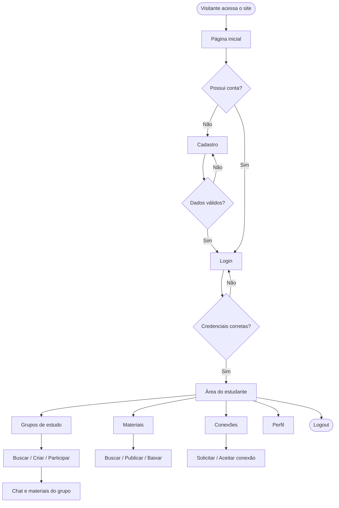
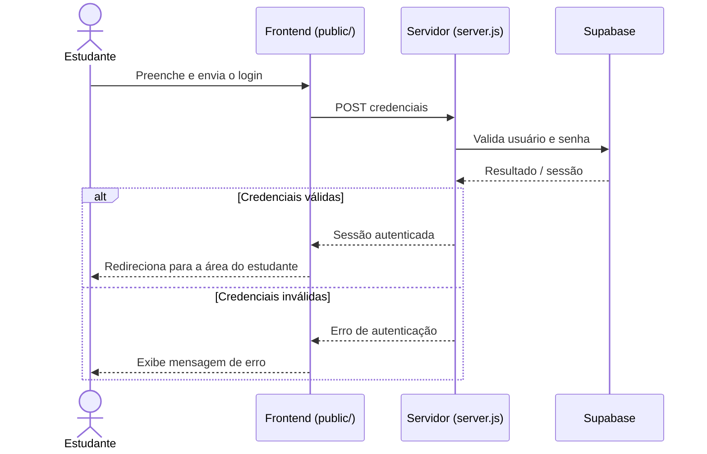
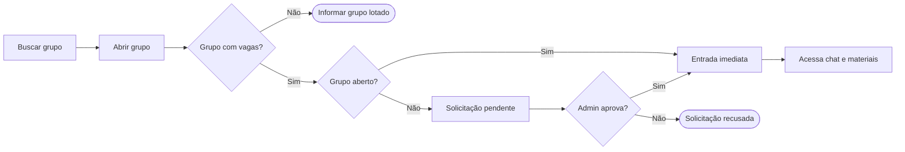
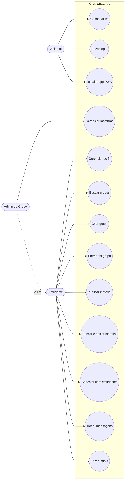
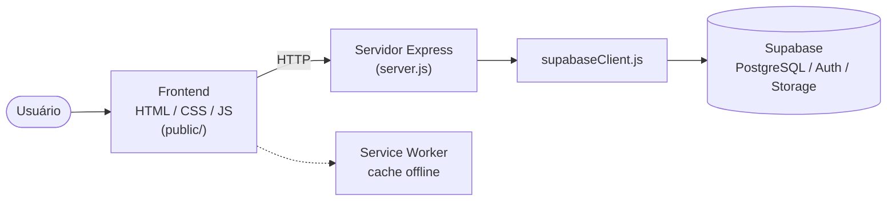

# C.O.N.E.C.T.A - Plataforma Acadêmica (MVP)

O **C.O.N.E.C.T.A** é uma plataforma desenvolvida para conectar universitários de todo o Brasil, facilitando a formação de grupos de estudo, o compartilhamento de materiais acadêmicos e o networking entre estudantes de diversas instituições de ensino.

🌐 **Acesso online:** [conecta-phi-five.vercel.app](https://conecta-phi-five.vercel.app/)

---

## Sumário

- [Funcionalidades](#funcionalidades)
- [Fluxo da aplicação](#fluxo-da-aplicação)
- [Casos de uso](#casos-de-uso)
- [Tecnologias utilizadas](#tecnologias-utilizadas)
- [Arquitetura](#arquitetura)
- [Estrutura do projeto](#estrutura-do-projeto)
- [Como executar](#como-executar)
- [PWA](#-pwa-progressive-web-app)
- [Documentação técnica](#documentação-técnica)

---

## Funcionalidades

Legenda: ✅ disponível · 🚧 em desenvolvimento / planejado

> Ajustar os status abaixo conforme o estado atual do código.

### Acesso e conta

| Status | Funcionalidade | Descrição |
|:---:|---|---|
| ✅ | **Cadastro** | O universitário cria sua conta informando nome, e-mail, senha, instituição, curso e período. |
| ✅ | **Login / Logout** | Autenticação por e-mail e senha, com sessão protegida. |
| 🚧 | **Perfil do estudante** | Edição de bio, foto, curso e período, visível para outros estudantes. |

### Grupos de estudo

| Status | Funcionalidade | Descrição |
|:---:|---|---|
| 🚧 | **Buscar grupos** | Filtro por disciplina, instituição ou nome. |
| 🚧 | **Criar grupo** | Define nome, descrição, disciplina, visibilidade (público/privado) e limite de membros. O criador vira administrador. |
| 🚧 | **Participar de grupos** | Entrada direta (grupo aberto) ou por solicitação com aprovação do administrador. |
| 🚧 | **Gerenciar membros** | O administrador aprova, recusa ou remove participantes. |
| 🚧 | **Chat do grupo** | Troca de mensagens entre os membros. |

### Materiais acadêmicos

| Status | Funcionalidade | Descrição |
|:---:|---|---|
| 🚧 | **Publicar material** | Upload de PDFs, resumos, listas de exercícios ou links, com título, disciplina e tipo. |
| 🚧 | **Biblioteca de materiais** | Busca por disciplina, tipo ou palavra-chave, com visualização e download. |
| 🚧 | **Materiais por grupo** | Materiais podem ser vinculados a um grupo ou ficar públicos. |

### Networking

| Status | Funcionalidade | Descrição |
|:---:|---|---|
| 🚧 | **Conexões** | Envio, aceite e recusa de solicitações de conexão entre estudantes de qualquer instituição. |

### Aplicativo (PWA)

| Status | Funcionalidade | Descrição |
|:---:|---|---|
| ✅ | **Instalação como app** | Instalável no celular e no computador. |
| ✅ | **Modo offline parcial** | Páginas já visitadas e arquivos estáticos ficam em cache; tela dedicada quando não há internet. |

---

## Fluxo da aplicação

### Visão geral da navegação



### Fluxo de autenticação



### Fluxo de participação em grupo de estudo



---

## Casos de uso

### Atores

| Ator | Descrição |
|---|---|
| **Visitante** | Pessoa não autenticada. |
| **Estudante** | Universitário cadastrado e autenticado. |
| **Administrador do Grupo** | Estudante que cria ou administra um grupo (herda as permissões do Estudante). |
| **Supabase** | Sistema externo de autenticação, banco e armazenamento. |

### Diagrama



### Resumo

| ID | Caso de uso | Ator | Descrição resumida |
|---|---|---|---|
| UC01 | Cadastrar-se | Visitante | Cria uma conta com e-mail único e senha protegida. |
| UC02 | Fazer login | Visitante | Autentica o usuário e inicia a sessão. |
| UC03 | Gerenciar perfil | Estudante | Atualiza nome, bio, foto, curso e período. |
| UC04 | Buscar grupos | Estudante | Pesquisa grupos públicos por filtros. |
| UC05 | Criar grupo | Estudante | Cria um grupo e se torna seu administrador. |
| UC06 | Entrar em grupo | Estudante | Participa diretamente ou solicita entrada. |
| UC07 | Gerenciar membros | Admin do Grupo | Aprova, recusa ou remove participantes. |
| UC08 | Publicar material | Estudante | Envia arquivo ou link com metadados acadêmicos. |
| UC09 | Buscar e baixar material | Estudante | Localiza e baixa materiais compartilhados. |
| UC10 | Conectar com estudantes | Estudante | Envia e responde solicitações de conexão. |
| UC11 | Trocar mensagens | Estudante | Conversa com os membros de um grupo. |
| UC12 | Instalar app (PWA) | Visitante / Estudante | Instala a plataforma como aplicativo. |
| UC13 | Fazer logout | Estudante | Encerra a sessão. |

### Exemplo detalhado — UC05: Criar grupo de estudo

| Campo | Descrição |
|---|---|
| **Ator principal** | Estudante |
| **Pré-condição** | Estudante autenticado. |
| **Pós-condição** | Grupo criado; criador registrado como `ADMIN`. |

**Fluxo principal**
1. O estudante escolhe "Criar grupo".
2. Informa nome, descrição, disciplina, visibilidade e limite de membros.
3. O sistema valida os dados e cria o grupo.
4. O sistema registra o criador como administrador.
5. O sistema exibe a página do grupo.

**Fluxo alternativo**
- *A1 – Dados inválidos:* o sistema destaca os campos incorretos e não cria o grupo.

**Regra de negócio:** todo grupo deve possuir ao menos um administrador.

> A especificação completa de todos os casos de uso está em [`docs/casos-de-uso.md`](docs/casos-de-uso.md).

---

## Tecnologias utilizadas

- **Backend:** Node.js, Express
- **Banco de dados / Auth / Storage:** Supabase (PostgreSQL)
- **Frontend:** HTML5, CSS3, JavaScript (Vanilla)
- **PWA:** Service Worker e Web App Manifest
- **Deploy:** Vercel
- **Controle de versão:** Git e GitHub

---

## Arquitetura



---

## Estrutura do projeto

```
Conecta/
├── docs/              # Diagramas e documentação técnica
├── public/
│   ├── assets/        # Imagens e logotipos (ex: CONECTA-LOGO.png)
│   ├── css/           # Estilizações (login.css, cadastro.css, etc.)
│   ├── icons/         # Ícones do app (PWA)
│   ├── js/            # Scripts do frontend (ex: pwa.js)
│   ├── pages/         # Telas HTML (index.html, login.html, cadastro.html)
│   ├── manifest.json  # Manifesto do PWA
│   ├── offline.html   # Tela exibida sem internet
│   └── sw.js          # Service worker
├── .gitignore         # Arquivos ignorados pelo Git (ex: node_modules)
├── package.json       # Dependências e scripts do projeto
├── package-lock.json  # Mapeamento de versões de dependências
├── README.md          # Documentação do repositório
├── server.js          # Servidor principal da aplicação em Express
└── supabaseClient.js  # Configuração do cliente Supabase
```

---

## Como executar

1. **Clonar o repositório**

   ```bash
   git clone https://github.com/ConectaAdm/Conecta.git
   ```

2. **Acessar a pasta do projeto**

   ```bash
   cd Conecta
   ```

3. **Instalar as dependências**

   ```bash
   npm install
   ```

4. **Configurar as variáveis de ambiente** (credenciais do Supabase, conforme usado em `supabaseClient.js`)

5. **Iniciar o servidor**

   ```bash
   node server.js
   ```

6. **Acessar no navegador:** abra http://localhost:3000 (ou a porta definida no console).

---

## 📲 PWA (Progressive Web App)

O CONECTA pode ser instalado como aplicativo no celular e no computador.

- **`public/manifest.json`** — nome, cores e ícones do app.
- **`public/sw.js`** — service worker: guarda CSS/JS/imagens em cache e mantém as páginas já visitadas disponíveis offline.
- **`public/js/pwa.js`** — registra o service worker e mostra o botão "Instalar app".
- **`public/offline.html`** — tela exibida quando não há internet.
- **`public/icons/`** — ícones do app.

**Como instalar:** no Chrome/Edge, clique em "📲 Instalar app" ou no ícone de instalação da barra de endereço. No iPhone (Safari): Compartilhar → "Adicionar à Tela de Início".

> Ao publicar mudanças em CSS/JS, aumente `CACHE_VERSION` em `public/sw.js` (ex.: `v1` → `v2`) para os usuários receberem a versão nova.

---

## Documentação técnica

| Documento | Descrição |
|---|---|
| [Diagrama de relacionamento (ER)](docs/diagrama-er.md) | Modelo de dados do banco. |
| [Diagrama de classes](docs/diagrama-classes.md) | Modelo de domínio e camadas da aplicação. |
| [Casos de uso](docs/casos-de-uso.md) | Especificação detalhada dos casos de uso. |
