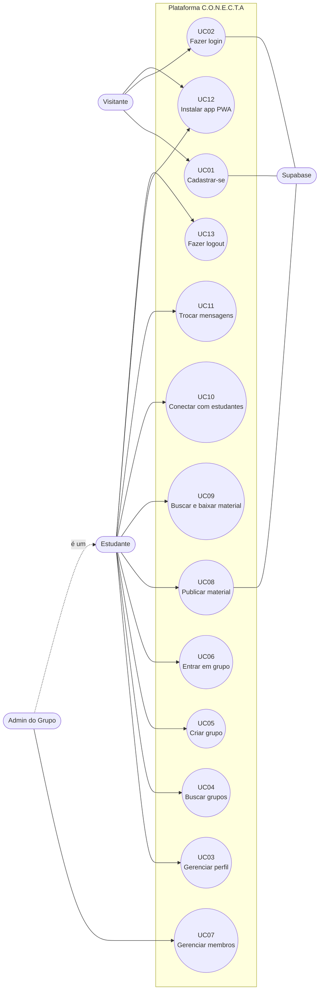

# Documento de Casos de Uso — C.O.N.E.C.T.A

> Plataforma acadêmica (MVP) para conectar universitários de todo o Brasil,
> facilitando grupos de estudo, compartilhamento de materiais e networking.
>
> ⚠️ Documento baseado no README e na estrutura pública do repositório
> (telas `index`, `login` e `cadastro`, backend Express e Supabase).
> Casos de uso ainda não implementados estão marcados como **Planejado**.

## 1. Atores

| Ator | Descrição |
|---|---|
| **Visitante** | Pessoa não autenticada que acessa a página inicial. |
| **Estudante** | Usuário autenticado (universitário cadastrado). |
| **Administrador do Grupo** | Estudante que criou ou administra um grupo de estudo. |
| **Supabase (sistema externo)** | Fornece autenticação, banco de dados e armazenamento. |

## 2. Diagrama de casos de uso

## 3. Resumo dos casos de uso

| ID | Caso de uso | Ator principal | Status |
|---|---|---|---|
| UC01 | Cadastrar-se | Visitante | Implementado (tela `cadastro`) |
| UC02 | Fazer login | Visitante | Implementado (tela `login`) |
| UC03 | Gerenciar perfil | Estudante | Planejado |
| UC04 | Buscar grupos de estudo | Estudante | Planejado |
| UC05 | Criar grupo de estudo | Estudante | Planejado |
| UC06 | Entrar em grupo de estudo | Estudante | Planejado |
| UC07 | Gerenciar membros do grupo | Admin do Grupo | Planejado |
| UC08 | Publicar material acadêmico | Estudante | Planejado |
| UC09 | Buscar e baixar material | Estudante | Planejado |
| UC10 | Conectar com outros estudantes | Estudante | Planejado |
| UC11 | Trocar mensagens no grupo | Estudante | Planejado |
| UC12 | Instalar app (PWA) | Visitante / Estudante | Implementado |
| UC13 | Fazer logout | Estudante | Implementado |

> Ajustar a coluna **Status** conforme o estado real do código.

---

## 4. Especificações detalhadas

### UC01 — Cadastrar-se

| Campo | Descrição |
|---|---|
| **Ator principal** | Visitante |
| **Descrição** | Permite que um universitário crie uma conta na plataforma. |
| **Pré-condições** | O visitante não possui conta com o e-mail informado. |
| **Pós-condições** | Conta criada e usuário apto a fazer login. |

**Fluxo principal**
1. O visitante acessa a tela de cadastro.
2. Informa nome, e-mail, senha, instituição, curso e período.
3. O sistema valida os dados.
4. O sistema registra o usuário no Supabase.
5. O sistema redireciona para a tela de login com mensagem de sucesso.

**Fluxos alternativos**
- **A1 – E-mail já cadastrado:** o sistema informa o erro e solicita outro e-mail.
- **A2 – Dados inválidos/incompletos:** o sistema destaca os campos e não prossegue.

**Regras de negócio**
- RN01: o e-mail deve ser único.
- RN02: a senha deve ter no mínimo 6 caracteres e nunca é armazenada em texto puro.

---

### UC02 — Fazer login

| Campo | Descrição |
|---|---|
| **Ator principal** | Visitante |
| **Descrição** | Autentica o estudante para acessar as funcionalidades da plataforma. |
| **Pré-condições** | Usuário já cadastrado. |
| **Pós-condições** | Sessão autenticada iniciada. |

**Fluxo principal**
1. O visitante acessa a tela de login.
2. Informa e-mail e senha.
3. O sistema valida as credenciais junto ao Supabase.
4. O sistema inicia a sessão e redireciona para a área do estudante.

**Fluxos alternativos**
- **A1 – Credenciais inválidas:** o sistema exibe mensagem de erro e permite nova tentativa.

---

### UC03 — Gerenciar perfil

| Campo | Descrição |
|---|---|
| **Ator principal** | Estudante |
| **Pré-condições** | Estudante autenticado. |
| **Pós-condições** | Dados do perfil atualizados. |

**Fluxo principal**
1. O estudante acessa seu perfil.
2. Edita nome, bio, curso, período e foto.
3. O sistema valida e salva as alterações.
4. O sistema exibe o perfil atualizado.

---

### UC04 — Buscar grupos de estudo

| Campo | Descrição |
|---|---|
| **Ator principal** | Estudante |
| **Pré-condições** | Estudante autenticado. |
| **Pós-condições** | Lista de grupos exibida conforme filtros. |

**Fluxo principal**
1. O estudante acessa a listagem de grupos.
2. Informa filtros (disciplina, instituição, nome).
3. O sistema retorna os grupos públicos correspondentes.

**Fluxo alternativo**
- **A1 – Nenhum resultado:** o sistema sugere criar um novo grupo.

---

### UC05 — Criar grupo de estudo

| Campo | Descrição |
|---|---|
| **Ator principal** | Estudante |
| **Pré-condições** | Estudante autenticado. |
| **Pós-condições** | Grupo criado; o criador torna-se Administrador do Grupo. |

**Fluxo principal**
1. O estudante escolhe "Criar grupo".
2. Informa nome, descrição, disciplina, visibilidade e limite de membros.
3. O sistema valida e cria o grupo.
4. O sistema registra o criador como membro com papel `ADMIN`.

**Regra de negócio**
- RN03: todo grupo deve possuir ao menos um administrador.

---

### UC06 — Entrar em grupo de estudo

| Campo | Descrição |
|---|---|
| **Ator principal** | Estudante |
| **Pré-condições** | Estudante autenticado; grupo existente e com vagas. |
| **Pós-condições** | Participação ativa ou pendente de aprovação. |

**Fluxo principal**
1. O estudante abre o grupo desejado.
2. Seleciona "Participar".
3. O sistema registra a solicitação (ou entrada direta, se o grupo for aberto).

**Fluxos alternativos**
- **A1 – Grupo lotado:** o sistema informa que o limite de membros foi atingido.
- **A2 – Já é membro:** o sistema exibe a área do grupo.

---

### UC07 — Gerenciar membros do grupo

| Campo | Descrição |
|---|---|
| **Ator principal** | Administrador do Grupo |
| **Pré-condições** | Usuário autenticado como `ADMIN` do grupo. |
| **Pós-condições** | Lista de membros atualizada. |

**Fluxo principal**
1. O administrador abre a lista de membros.
2. Aprova/recusa solicitações pendentes ou remove membros.
3. O sistema atualiza o status e notifica o estudante afetado.

---

### UC08 — Publicar material acadêmico

| Campo | Descrição |
|---|---|
| **Ator principal** | Estudante |
| **Pré-condições** | Estudante autenticado (e membro do grupo, se publicar em grupo). |
| **Pós-condições** | Material disponível para consulta. |

**Fluxo principal**
1. O estudante escolhe "Publicar material".
2. Informa título, descrição, disciplina, tipo e anexa arquivo ou link.
3. O sistema valida e armazena o arquivo no Supabase Storage.
4. O sistema registra o material e o exibe na listagem.

**Fluxos alternativos**
- **A1 – Arquivo acima do limite/tipo não suportado:** o sistema rejeita o envio.

---

### UC09 — Buscar e baixar material

| Campo | Descrição |
|---|---|
| **Ator principal** | Estudante |
| **Pré-condições** | Estudante autenticado. |
| **Pós-condições** | Material visualizado ou baixado. |

**Fluxo principal**
1. O estudante acessa a biblioteca de materiais.
2. Filtra por disciplina, tipo ou palavra-chave.
3. Seleciona um material e solicita o download/visualização.
4. O sistema disponibiliza o arquivo.

---

### UC10 — Conectar com outros estudantes (networking)

| Campo | Descrição |
|---|---|
| **Ator principal** | Estudante |
| **Pré-condições** | Estudante autenticado. |
| **Pós-condições** | Conexão criada com status `PENDENTE` ou `ACEITA`. |

**Fluxo principal**
1. O estudante busca outro estudante por nome, curso ou instituição.
2. Envia solicitação de conexão.
3. O destinatário aceita ou recusa.
4. O sistema atualiza o status da conexão.

**Regra de negócio**
- RN04: não é possível conectar-se consigo mesmo nem duplicar uma conexão.

---

### UC11 — Trocar mensagens no grupo

| Campo | Descrição |
|---|---|
| **Ator principal** | Estudante |
| **Pré-condições** | Estudante é membro ativo do grupo. |
| **Pós-condições** | Mensagem registrada e visível aos membros. |

**Fluxo principal**
1. O estudante abre o chat do grupo.
2. Digita e envia a mensagem.
3. O sistema registra e exibe para os demais membros.

---

### UC12 — Instalar app (PWA)

| Campo | Descrição |
|---|---|
| **Ator principal** | Visitante / Estudante |
| **Descrição** | Instala a plataforma como aplicativo no celular ou computador. |

**Fluxo principal**
1. O sistema registra o service worker (`sw.js`) e exibe o botão "📲 Instalar app" (`pwa.js`).
2. O usuário aciona o botão.
3. O navegador instala o app com ícone e manifesto (`manifest.json`).

**Fluxo alternativo**
- **A1 – Sem internet:** o sistema exibe `offline.html` e mantém páginas já visitadas em cache.

---

### UC13 — Fazer logout

| Campo | Descrição |
|---|---|
| **Ator principal** | Estudante |
| **Fluxo principal** | O estudante aciona "Sair"; o sistema encerra a sessão e redireciona para a página inicial. |

---

## 5. Requisitos não funcionais relacionados

| ID | Requisito |
|---|---|
| RNF01 | Interface responsiva e instalável (PWA) com suporte offline parcial. |
| RNF02 | Senhas protegidas e comunicação via HTTPS (deploy na Vercel). |
| RNF03 | Dados persistidos no Supabase (PostgreSQL). |
| RNF04 | Compatibilidade com Chrome, Edge e Safari (iOS). |
