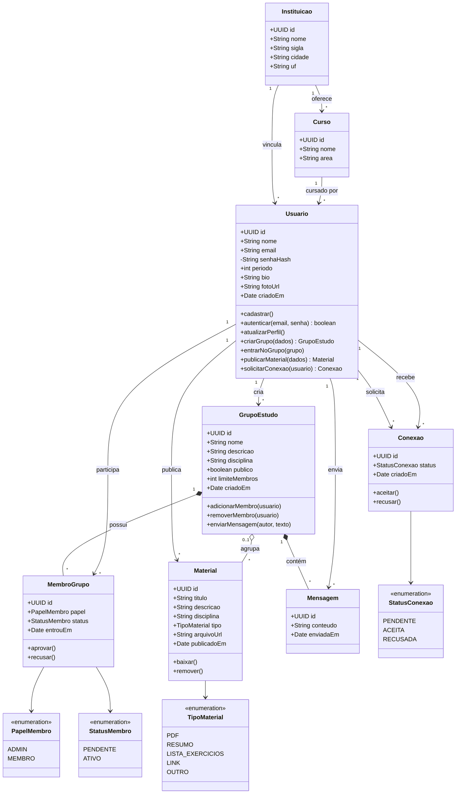
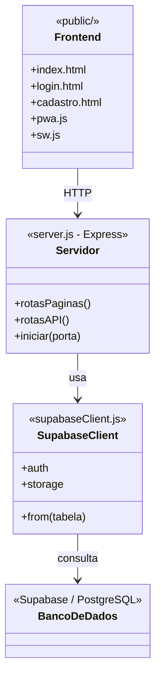

# Diagrama de Classes — C.O.N.E.C.T.A

> Modelo de domínio proposto para o MVP. O backend atual é Node.js + Express
> (`server.js`) com acesso ao Supabase (`supabaseClient.js`); as classes abaixo
> representam as entidades e serviços lógicos do sistema.
>
> ⚠️ Revisar contra o código real antes de publicar.

## Modelo de domínio

## Camadas da aplicação

