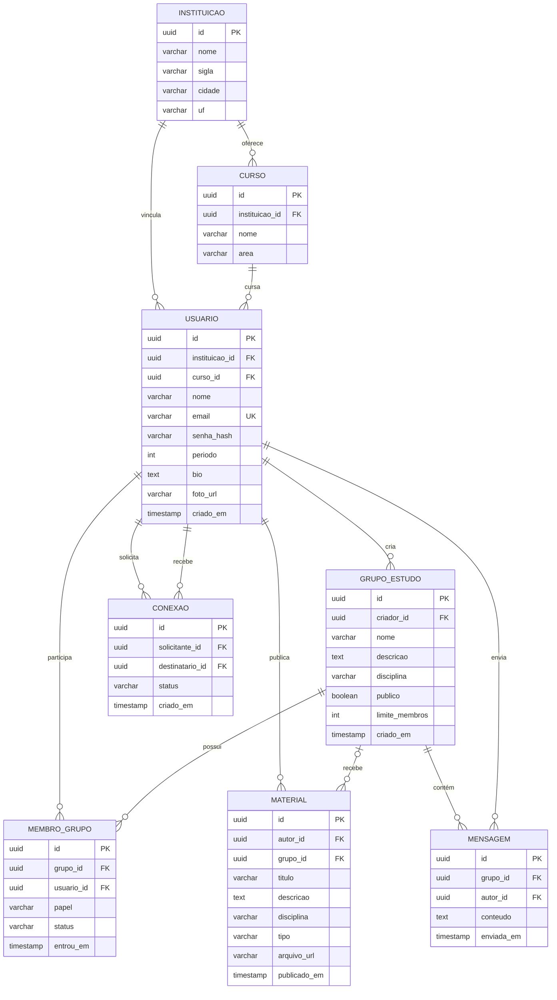

# Diagrama de Relacionamento (ER) — C.O.N.E.C.T.A

> Modelo de dados proposto para o MVP da plataforma acadêmica C.O.N.E.C.T.A
> (grupos de estudo, compartilhamento de materiais e networking entre universitários).
> Banco de dados: **Supabase (PostgreSQL)**.
>
> ⚠️ Revisar nomes de tabelas/colunas contra o schema real do Supabase antes de publicar.

## Diagrama

## Dicionário resumido

| Tabela | Descrição |
|---|---|
| `INSTITUICAO` | Universidades/faculdades de todo o Brasil. |
| `CURSO` | Cursos oferecidos por uma instituição. |
| `USUARIO` | Estudante cadastrado (tela de cadastro/login). |
| `GRUPO_ESTUDO` | Grupo criado por um usuário para estudar uma disciplina. |
| `MEMBRO_GRUPO` | Associativa N:N entre usuário e grupo (papel: `admin`/`membro`; status: `pendente`/`ativo`). |
| `MATERIAL` | Material acadêmico compartilhado, opcionalmente vinculado a um grupo. |
| `CONEXAO` | Relacionamento de networking entre dois usuários (status: `pendente`/`aceita`/`recusada`). |
| `MENSAGEM` | Mensagens trocadas dentro de um grupo. |

## Regras de integridade

- `USUARIO.email` é único.
- `MEMBRO_GRUPO` possui restrição única em (`grupo_id`, `usuario_id`).
- `CONEXAO` possui restrição única em (`solicitante_id`, `destinatario_id`) e `solicitante_id <> destinatario_id`.
- `MATERIAL.grupo_id` é opcional (material pode ser público, fora de grupo).
